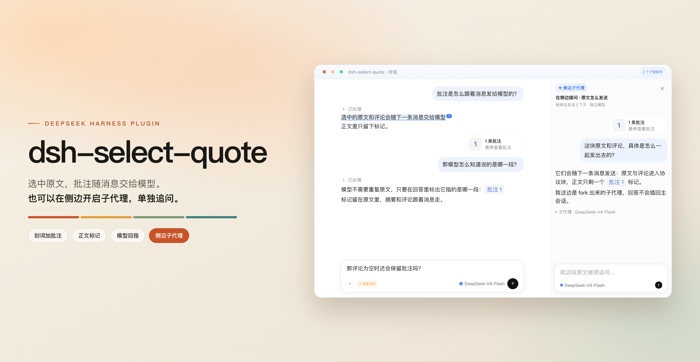

# dsh-select-quote

[简体中文](README.md) | English

A [DeepSeek Harness](https://deepseek-harness.github.io/deepseek-harness/guide/quickstart) client plugin: selection annotations and quotes, in-place translation, and sidebar subagent questions. The selected text and your comment ride along with the next message; the text keeps its highlight and ordinal mark for jumping back.

[](https://dshopen.org/zh/plugins/dsh-select-quote/)
[](https://awesome-dsh-plugin.com/)
[](https://www.npmjs.com/package/dsh-select-quote)
[](package.json)



## Features

- **Selection toolbar**: select text in the conversation or in a Sidebar file preview to get **Open link / Copy / Translate / Annotate / Ask in sidebar**
- **In-place translation**: streams next to the selection; the target follows the UI language by default and the result copies in one click, with per-session cache reuse
- **Annotate and send**: **Annotate this conversation** is the main button, its chevron sends the passage elsewhere; the source keeps an arrow mark, the target shows "From: <session>", and both sides jump back
- **Marks and summary**: annotated text keeps a tint and an ordinal mark; "N annotations" above the composer edits, deletes, or jumps back, and clears on send
- **Sidebar subagents**: ask about one passage without interrupting the main conversation; pick a separate model, or reuse the same subagent
- **Eight UI languages**: 简体中文 / English / 日本語 / Español / Français / Deutsch / Русский / Português

## Install

Web:

```bash
dsh plugin --profile web add dsh-select-quote
dsh --profile web
```

Desktop: enter `dsh-select-quote` inside the app, then restart the client. Development commands (`check` / `sync:web` / `release`), publishing and the internal conventions live in [`docs/internals.md`](docs/internals.md).

## Usage

Click **Annotate** on a selection and it is saved at once; `Enter` or `⌘/Ctrl + Enter` submits, `Shift + Enter` adds a line. Click "N annotations" to edit or jump back. In the chevron panel, **Send** keeps you here and **Send and open** goes to the target.

| Action | Desktop macOS | Desktop Win/Linux | Web macOS | Web Windows | Web Linux |
|---|---|---|---|---|---|
| Open selection menu | `⌘L` | `Ctrl+Shift+L` | `⇧⌘L` | `Ctrl+Shift+L` | `Ctrl+Shift+,` |
| Annotate | `⇧⌘L` | `Ctrl+Shift+.` | `⌥⌘L` | `Ctrl+Shift+.` | `Ctrl+Shift+.` |

## Settings

Plugin page → `dsh-select-quote`; the settings sit behind five tabs — **Entry** (trigger, placement, host-surface merge), **Buttons** (four switches), **Translation** (target, same-language hiding, model, prompt), **Side task** (subagent reuse) and **Shortcuts**. Each row explains itself, and the last tab you opened is remembered.

**Keep at least one button on**: with every switch off the toolbar is empty, so the last switch refuses to turn off and says why.

Limitations, host version requirements and known issues live in [`docs/limitations.md`](docs/limitations.md).

## License

[MIT](LICENSE) © 2026 agan · thanks to [@imallakov](https://github.com/imallakov) (multilingual support and cross-platform builds), [@Ladersbt](https://github.com/Ladersbt), [@EliteOtaku](https://github.com/EliteOtaku).
