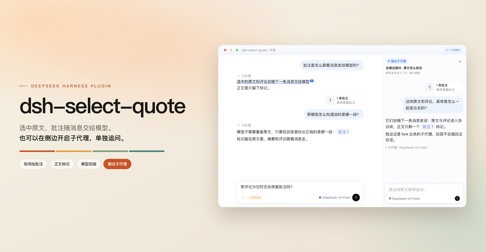

# dsh-select-quote

简体中文 | [English](README.en.md)

[DeepSeek Harness](https://deepseek-harness.github.io/deepseek-harness/guide/quickstart) 客户端插件：为 DSH 增加**划词批注、引用**、**划词翻译**、**侧边子代理提问**，链接用**默认浏览器**打开。选中的原文连同评论随下一条消息交给模型；对话正文保留高亮与序号角标、可跳回原文，右侧文件预览里的选区按纯文本引用。菜单可划词浮出或从右键打开，翻译可单独指定模型。

[](https://dshopen.org/zh/plugins/dsh-select-quote/)
[](https://awesome-dsh-plugin.com/)
[](https://www.npmjs.com/package/dsh-select-quote)
[](package.json)



## 功能

- **划词工具条**：选中对话正文或右侧文件预览里的文字，浮出「打开链接 / 复制 / 翻译 / 批注 / 在侧边提问」；文件预览里不含「在侧边提问」。可选显示在选区上方或下方
- **就地翻译**：译文在选区旁流式出现，思考过程实时展开、完成后折叠可查；目标语言默认跟随界面语言，可随时切换，结果一键复制；原文与设置相同则复用会话内缓存，不再调模型
- **右键菜单与快捷键**：同一套操作也能从右键或键盘打开，键位可在宿主设置里改
- **批注摘要**：输入框上方显示「N 条批注」，可展开编辑、跳回原文；删除需再点一次「确认移除」；发送后随消息清除
- **正文标记**：划中的文字留下底色与角标，点角标查看原文与评论；待发批注可在角标浮层里直接编辑或删除
- **批注 / 放入**：工具条上的「批注 当前会话」是主键——点它就是留在当前会话；右侧下拉打开「放入到」面板，第一行「当前会话」，其下是「新会话」和各会话，选好再点「放入」留在当前页或「放入并前往」。源正文留下箭头角标，目标批注卡显示「来自：<会话>」，可双向跳回
- **模型回指**：模型回答里指向某条批注时渲染成带预览的 chip
- **侧边子代理**：就对话里的某段原文单独追问，在右侧栏开启子代理，不打断主会话；可独立选模型与推理等级，也可复用同一个
- **八种界面语言**：简体中文 / English / 日本語 / Español / Français / Deutsch / Русский / Português

## 安装

网页版：

```bash
dsh plugin --profile web add dsh-select-quote
dsh --profile web
```

桌面版：在应用内输入 `dsh-select-quote` 安装，或到插件页搜索安装，重启客户端生效。

本地开发：

```bash
git clone https://github.com/latte03/dsh-select-quote && cd dsh-select-quote
pnpm install && pnpm run build
cp dev.patch.example.yml dev.patch.yml   # 把 <CHECKOUT> 改成当前目录的绝对路径
dsh web --patch "$PWD/dev.patch.yml"
```

打开 `http://127.0.0.1:3080` 即可试用。`dev.patch.yml` 是未跟踪的本机文件，仓库只提供模板。

## 用法

1. 在对话正文或右侧文件预览中选中文字 → 点「批注」（主键），批注立即保存；可在评论框补充，`Enter` 或 `⌘/Ctrl + Enter` 提交，`Shift + Enter` 换行
2. 悬停（触屏点按）输入框上方的摘要展开列表，编辑、删除或跳回正文；点正文角标查看预览
3. 正常发送：批注随消息交给模型，摘要消失，正文标记保留；模型回指处显示 chip
4. 「在侧边提问」先打开输入框，点发送才创建子代理并在右侧栏打开；目录用「在侧边提问 · 问题摘要」命名
5. 「翻译」直接打开译文浮层并开始流式翻译：顶栏换语言，「停止」可中断；完成后用右下角图标复制
6. 点「批注 当前会话」右侧的下拉打开「放入到」面板（第一行就是当前会话），挑一个会话后点「放入」留在当前页、点「放入并前往」打开目标；目标输入框里的条目带「来自」，点它回到原文

选中文字后有三种方式打开菜单：自动浮出（默认）、选区右键、快捷键。触屏始终使用底部操作条。

| 操作 | 桌面 macOS | 桌面 Win/Linux | Web macOS | Web Windows | Web Linux |
|---|---|---|---|---|---|
| 打开划词菜单 | `⌘L` | `Ctrl+Shift+L` | `⇧⌘L` | `Ctrl+Shift+L` | `Ctrl+Shift+,` |
| 批注 | `⇧⌘L` | `Ctrl+Shift+.` | `⌥⌘L` | `Ctrl+Shift+.` | `Ctrl+Shift+.` |

## 设置

插件页 → `dsh-select-quote`，配置直接显示在插件外层页面：

- **划词入口**：自动浮出 / 右键菜单 / 两者都开，默认自动浮出
- **浮层位置**：下方（默认）/ 上方，放不下自动翻面（并入宿主浮层时本项隐藏）
- **划词按钮**：在划词工具条和右键菜单里显示或隐藏「复制」「翻译」「在侧边提问」，三项默认全开
- **并入宿主浮层**：把我们的按钮放进官方那条划词浮层里（引用文本 + 复制 / 翻译 / 批注 当前会话 + 下拉），原文旁不再另起一条；默认关闭
- **设置入口**：工具条末尾的齿轮直接跳到插件页，配置就在那一页外层
- **快捷键**：开关两个命令并显示当前键位，改键在宿主的「快捷键」设置里
- **侧边提问的子代理**：每次独立（默认）/ 复用同一个；复用时目录只留一条，上下文与模型停在第一次创建时
- **翻译目标语言**：自动（跟随界面语言；原文已是该语言时译成英文）或固定八种之一
- **同语言隐藏翻译**：选中文字已是目标语言时不再显示「翻译」（默认关闭）
- **翻译模型**：默认跟随当前对话，也可单独选一个更快的
- **自定义提示词**：占位文字即内置提示；留空用内置，填写后整段覆盖，`{target}` 替换为目标语言

## 语言

界面语言跟随 dsh 的语言设置，插件界面与插件页标题、描述一起切换，共八种。

## 已知限制

- **批注按会话持久化**：未发送的批注保留最近 20 个会话 / 7 天，刷新或重启后回来，发送即清除；分叉会话不继承
- **放入其他会话依赖当前 dsh 版本**：需要宿主提供工作区与 `openSession`，旧版本自动隐藏入口；未发送的放入记录按 20 会话 / 7 天成对淘汰，目标发送后源角标永久保留，从目标跳回只保证已加载的历史
- **不碰用户气泡**：批注卡挂在 `conversation.chat.user.before` 装饰席位，气泡、附件、时间与复制行全归宿主；协议块由 `uiConversation.userText` 规则剥离。需要 dsh ≥ 0.2.2-rc.1
- **划词范围**：对话正文与右侧文件预览可划词；文件树、编辑器、终端等其它面板不介入。文件预览里没有「在侧边提问」，划词也不会改变文件正文。键盘用户需借助光标浏览或辅助技术建立选区
- **侧边提问要先发送**：宿主不允许在空会话上直接开子代理；复用模式没有模型入口
- **翻译只发选区**：不带会话上下文，也不写入批注；单次上限约 6000 字、超时 90 秒，失败时浮层显示错误摘要，详情在控制台
- **Web Linux 快捷键受限**：宿主只接受 `Ctrl+/`、`Ctrl+Shift+,`、`Ctrl+Shift+.`，本插件用后两个

## 开发

```bash
pnpm run check          # typecheck + test + build + verify，提交前必跑
pnpm run watch          # 增量重建
pnpm run sync:web       # 推到网页版已安装副本（桌面版用 sync:desktop）
pnpm run release        # check → CHANGELOG → 版本号 + tag
```

`lib/` 随源码一起提交，运行时直接读取。发布走 `npm publish --registry=https://registry.npmjs.org/`，再推 npmmirror 镜像同步。机制、内部约定与排错见 [`docs/internals.md`](docs/internals.md)。

## 致谢

[@imallakov](https://github.com/imallakov)（多语言与跨平台构建）、[@Ladersbt](https://github.com/Ladersbt)（chip 预览反馈）、[@EliteOtaku](https://github.com/EliteOtaku)（桌面端问题定位）。

## License

[MIT](LICENSE) © 2026 agan
